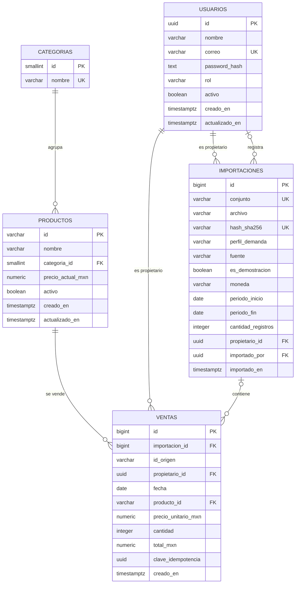

# Modelo de datos y normalización

Documento de diseño de la base de datos PostgreSQL del backend de Proyecto
ReneFULL. La fuente ejecutable es `app/db/models.py` y la migración
`migrations/versions/0001_esquema_inicial.py`; este documento describe el modelo
implementado y verificado.

Alcance: usuarios, catálogo de productos, importaciones y ventas. Las
estadísticas y las predicciones se calculan a partir de estas tablas. Las
predicciones no se persisten.

## 1. Convenciones

- Motor: PostgreSQL 16 o superior. La verificación local se realizó con
  PostgreSQL 17.11.
- ORM y migraciones: SQLAlchemy 2 y Alembic. El driver es psycopg 3.
- Identificadores de usuario: `uuid` generado con `gen_random_uuid()`.
- Tablas transaccionales: clave primaria `bigint` con `GENERATED BY DEFAULT AS
  IDENTITY`.
- Catálogo de productos: clave natural `varchar(20)` con formato
  `^[A-Z]{1,3}[0-9]{3}$`.
- Dinero: `numeric(12,2)` o `numeric(14,2)`, nunca punto flotante.
- Fechas de negocio: `date`. Marcas de tiempo: `timestamptz`.
- Los nombres lógicos de las restricciones se prefijan con `ck_`, `fk_`, `pk_`,
  `uq_` o `ix_` mediante la convención de Alembic.

Los cinco archivos de `data/demo/` son datos simulados de demostración. No son
ventas reales y no se consultan en tiempo de ejecución: solo alimentan la carga
inicial.

## 2. Diagrama entidad-relación



La relación `USUARIOS -> IMPORTACIONES` aparece dos veces porque
`propietario_id` es obligatorio y `importado_por` es opcional. La relación
`IMPORTACIONES -> VENTAS` es opcional en el lado de la venta: una venta capturada
manualmente no pertenece a una importación.

## 3. Modelo relacional

```text
usuarios(
  id PK,
  nombre,
  correo UK,
  password_hash,
  rol,
  activo,
  creado_en,
  actualizado_en
)

categorias(
  id PK,
  nombre UK
)

productos(
  id PK,
  nombre,
  categoria_id FK -> categorias.id,
  precio_actual_mxn,
  activo,
  creado_en,
  actualizado_en
)

importaciones(
  id PK,
  conjunto UK,
  archivo,
  hash_sha256 UK,
  perfil_demanda,
  fuente,
  es_demostracion,
  moneda,
  periodo_inicio,
  periodo_fin,
  cantidad_registros,
  propietario_id FK -> usuarios.id,
  importado_por FK -> usuarios.id,
  importado_en,
  UK(id, propietario_id)
)

ventas(
  id PK,
  importacion_id FK compuesta,
  id_origen,
  propietario_id FK -> usuarios.id,
  fecha,
  producto_id FK -> productos.id,
  precio_unitario_mxn,
  cantidad,
  total_mxn,
  clave_idempotencia,
  creado_en,
  FK(importacion_id, propietario_id) -> importaciones(id, propietario_id)
)
```

### 3.1 Cardinalidades

| Relación | Cardinalidad | Regla |
| --- | --- | --- |
| `usuarios` - `ventas` | 1 : 0..N | Toda venta tiene un propietario activo o inactivo; las consultas solo usan propietarios activos. |
| `usuarios` - `importaciones` | 1 : 0..N | Toda importación tiene un cliente propietario. |
| `usuarios` - `importaciones` por `importado_por` | 0..1 : 0..N | Una importación puede registrar qué administrador la ejecutó. |
| `categorias` - `productos` | 1 : 0..N | Un producto pertenece a una sola categoría. |
| `productos` - `ventas` | 1 : 0..N | Toda venta referencia un producto existente. |
| `importaciones` - `ventas` | 0..1 : 0..N | Las ventas importadas pertenecen a una importación; las manuales no. |

La llave foránea compuesta
`ventas(importacion_id, propietario_id) -> importaciones(id, propietario_id)`
impide asociar una venta a una importación de otro cliente. No basta con
comparar identificadores en la aplicación.

## 4. Diccionario de datos

### 4.1 `usuarios`

| Columna | Tipo | Nulo | Valor por defecto | Restricciones | Descripción |
| --- | --- | --- | --- | --- | --- |
| `id` | `uuid` | No | `gen_random_uuid()` | PK | Identificador de la cuenta. |
| `nombre` | `varchar(120)` | No | — | CHECK de longitud recortada entre 1 y 120 | Nombre visible. |
| `correo` | `varchar(254)` | No | — | UNIQUE; CHECK de minúsculas | Correo normalizado; se usa para iniciar sesión. |
| `password_hash` | `text` | No | — | CHECK de prefijo `$argon2id$` | Hash Argon2id; nunca se guarda la contraseña. |
| `rol` | `varchar(20)` | No | — | CHECK `cliente` o `administrador` | Rol autorizado por el servidor. |
| `activo` | `boolean` | No | `true` | — | Una cuenta inactiva no puede operar. |
| `creado_en` | `timestamptz` | No | `now()` | — | Fecha de creación. |
| `actualizado_en` | `timestamptz` | No | `now()` | — | Última actualización registrada por el servicio. |

Índice: `ix_usuarios_rol` para filtros administrativos por rol.

### 4.2 `categorias`

| Columna | Tipo | Nulo | Valor por defecto | Restricciones | Descripción |
| --- | --- | --- | --- | --- | --- |
| `id` | `smallint` | No | Identidad | PK | Identificador de la categoría. |
| `nombre` | `varchar(60)` | No | — | UNIQUE; CHECK de longitud recortada entre 1 y 60 | Nombre de la categoría. |

### 4.3 `productos`

| Columna | Tipo | Nulo | Valor por defecto | Restricciones | Descripción |
| --- | --- | --- | --- | --- | --- |
| `id` | `varchar(20)` | No | — | PK; CHECK `^[A-Z]{1,3}[0-9]{3}$` | Clave natural del producto. |
| `nombre` | `varchar(120)` | No | — | CHECK de longitud recortada entre 1 y 120 | Nombre del producto. |
| `categoria_id` | `smallint` | No | — | FK a `categorias.id`; `ON DELETE RESTRICT` | Categoría del producto. |
| `precio_actual_mxn` | `numeric(12,2)` | No | — | CHECK mayor que cero | Precio de catálogo vigente. |
| `activo` | `boolean` | No | `true` | — | Indica si el producto sigue disponible. |
| `creado_en` | `timestamptz` | No | `now()` | — | Fecha de creación. |
| `actualizado_en` | `timestamptz` | No | `now()` | — | Última actualización registrada por el servicio. |

Índice: `ix_productos_categoria_id`.

### 4.4 `importaciones`

| Columna | Tipo | Nulo | Valor por defecto | Restricciones | Descripción |
| --- | --- | --- | --- | --- | --- |
| `id` | `bigint` | No | Identidad | PK | Identificador de la importación. |
| `conjunto` | `varchar(80)` | No | — | UNIQUE; CHECK de longitud recortada entre 1 y 80 | Nombre lógico del conjunto de demostración. |
| `archivo` | `varchar(255)` | No | — | — | Nombre del archivo de origen. |
| `hash_sha256` | `varchar(64)` | No | — | UNIQUE; CHECK de 64 hexadecimales | Huella del contenido para idempotencia. |
| `perfil_demanda` | `varchar(80)` | No | — | — | Perfil declarado por el conjunto. |
| `fuente` | `varchar(40)` | No | `datos_simulados` | — | Origen del contenido. |
| `es_demostracion` | `boolean` | No | `true` | — | Marca los datos simulados. |
| `moneda` | `varchar(3)` | No | `MXN` | CHECK igual a `MXN` | Moneda del conjunto. |
| `periodo_inicio` | `date` | No | — | CHECK junto con `periodo_fin` | Inicio del periodo declarado. |
| `periodo_fin` | `date` | No | — | CHECK `periodo_inicio <= periodo_fin` | Fin del periodo declarado. |
| `cantidad_registros` | `integer` | No | — | CHECK mayor que cero | Ventas declaradas por el archivo. |
| `propietario_id` | `uuid` | No | — | FK a `usuarios.id`; `ON DELETE RESTRICT` | Cliente dueño de las ventas importadas. |
| `importado_por` | `uuid` | Sí | `NULL` | FK a `usuarios.id`; `ON DELETE SET NULL` | Administrador que ejecutó la carga, si se indicó. |
| `importado_en` | `timestamptz` | No | `now()` | — | Fecha de la carga. |

Restricciones: `UNIQUE(conjunto)`, `UNIQUE(hash_sha256)` y
`UNIQUE(id, propietario_id)`. La última es el destino de la llave foránea
compuesta de `ventas`. Índice: `ix_importaciones_propietario_id`.

### 4.5 `ventas`

| Columna | Tipo | Nulo | Valor por defecto | Restricciones | Descripción |
| --- | --- | --- | --- | --- | --- |
| `id` | `bigint` | No | Identidad | PK | Identificador interno de la venta. |
| `importacion_id` | `bigint` | Sí | `NULL` | Parte de la FK compuesta a `importaciones` | Importación de origen; nulo en ventas manuales. |
| `id_origen` | `varchar(64)` | Sí | `NULL` | CHECK de longitud recortada entre 1 y 64 | Identificador de la venta dentro del archivo. |
| `propietario_id` | `uuid` | No | — | FK a `usuarios.id`; `ON DELETE RESTRICT` | Cliente dueño de la venta. |
| `fecha` | `date` | No | — | CHECK mayor o igual a `2000-01-01` | Fecha de la venta. |
| `producto_id` | `varchar(20)` | No | — | FK a `productos.id`; `ON DELETE RESTRICT` | Producto vendido. |
| `precio_unitario_mxn` | `numeric(12,2)` | No | — | CHECK mayor que cero y menor o igual a 1,000,000 | Precio histórico de la venta. |
| `cantidad` | `integer` | No | — | CHECK entre 1 y 10,000 | Unidades vendidas. |
| `total_mxn` | `numeric(14,2)` | No | — | CHECK mayor que cero, menor o igual a 10,000,000 y coherente | Total histórico de la venta. |
| `clave_idempotencia` | `uuid` | Sí | `NULL` | Índice único parcial por propietario | Evita duplicar capturas manuales reintentadas. |
| `creado_en` | `timestamptz` | No | `now()` | — | Fecha de registro. |

Reglas de coherencia:

- `importacion_id` y `id_origen` deben ser ambos nulos o ambos no nulos.
- `abs(total_mxn - precio_unitario_mxn * cantidad) <= 0.01`.
- La pareja `(importacion_id, id_origen)` es única cuando `importacion_id` no es
  nulo.
- La pareja `(propietario_id, clave_idempotencia)` es única cuando la clave no es
  nula.
- La FK compuesta garantiza que la importación y la venta tengan el mismo
  propietario.

Índices:

| Índice | Columnas | Propósito |
| --- | --- | --- |
| `ix_ventas_propietario_fecha` | `propietario_id, fecha` | Listados y estadísticas por cliente. |
| `ix_ventas_producto_fecha` | `producto_id, fecha` | Agregaciones por producto. |
| `ix_ventas_fecha` | `fecha` | Filtros temporales y periodos. |
| `ix_ventas_importacion` | `importacion_id` | Ventas de una importación. |
| `uq_ventas_importacion_origen` | `importacion_id, id_origen` (parcial) | Idempotencia de archivos. |
| `uq_ventas_propietario_idempotencia` | `propietario_id, clave_idempotencia` (parcial) | Idempotencia de capturas manuales. |

## 5. Normalización

### 5.1 Primera forma normal (1FN)

Los valores son atómicos. El JSON de entrada contiene `metadata` y una lista
`ventas`, pero no se guarda como documento: se descompone en filas de
`importaciones` y `ventas`. Los datos repetidos de producto y categoría se
resuelven mediante `productos` y `categorias`.

### 5.2 Segunda forma normal (2FN)

Las tablas transaccionales usan una clave primaria simple. En `ventas`, todos
los atributos dependen de `ventas.id`; el producto y su categoría no se copian,
se referencian. En `importaciones`, los metadatos dependen de
`importaciones.id`. No hay dependencias parciales de una clave compuesta.

### 5.3 Tercera forma normal (3FN)

- `categorias.nombre` depende solo de `categorias.id`; no se repite en
  `productos` ni en `ventas`.
- `productos.nombre` y `productos.categoria_id` dependen de `productos.id`.
- `usuarios.rol`, `usuarios.correo` y `usuarios.password_hash` dependen de
  `usuarios.id`.
- `ventas` no contiene nombre de producto, categoría, nombre del cliente ni
  correo; esos datos se obtienen por llave foránea.
- `importaciones` separa al propietario de la importación y al administrador que
  la ejecutó.

El modelo está en 3FN para las entidades y catálogos. Se conservan dos valores
históricos con redundancia controlada:

1. `ventas.precio_unitario_mxn` no es una copia de
   `productos.precio_actual_mxn`: el primero es el precio aplicado en la venta y
   el segundo el precio vigente del catálogo.
2. `ventas.total_mxn` es el total histórico de la operación. Se conserva para
   auditoría y se protege con una restricción de coherencia. Si se eliminara, el
   total tendría que recalcularse en cada consulta y se perdería el valor
   registrado originalmente.

No se almacenan predicciones ni resultados derivados de estadísticas.

## 6. Integridad, borrado y seguridad de datos

- `ON DELETE RESTRICT` protege usuarios con ventas o importaciones, productos
  con ventas y categorías con productos.
- `importado_por` usa `ON DELETE SET NULL` porque es un dato de auditoría
  opcional; la importación y sus ventas permanecen.
- No hay borrado en cascada de ventas.
- Las consultas de cliente reciben el propietario desde la identidad
  autenticada, no desde el cuerpo ni la URL.
- Las consultas de lectura aplican filtros de validez y vuelven a validar cada
  fila antes de devolverla.
- Las cuentas administrativas se verifican en la base de datos; un rol enviado
  por el cliente no se usa para autorizar.
- `actualizado_en` no se modifica por un trigger: los servicios que actualizan
  usuarios o productos lo asignan explícitamente.

## 7. DDL ejecutable

El DDL oficial es la migración de Alembic. No se mantiene un segundo script SQL
duplicado porque podría desviarse del modelo. Para obtener el esquema:

```powershell
cd Backend
alembic upgrade head
```

Para exportar una referencia de solo esquema desde una base ya migrada:

```powershell
pg_dump --schema-only --no-owner --no-privileges --file=esquema_referencia.sql proyectorenefull
```

La migración `0001_esquema_inicial.py` crea las cinco tablas, las llaves, los
índices y las restricciones. `alembic check` se ejecutó sin diferencias entre los
modelos y la migración.

## 8. Trazabilidad

- `tests/test_migracion.py` verifica la creación de tablas, índices y
  restricciones.
- `tests/test_importacion.py` verifica la carga y la idempotencia.
- `tests/test_consultas.py` verifica aislamiento, filas inválidas y agregados.
- `tests/test_ml.py` verifica el uso de ventas válidas y el corte semanal.
- `tests/test_passwords_usuarios.py` verifica roles, correo y contraseñas.

Los detalles de procesos y validaciones están en `PROCESOS.md` y
`VALIDACIONES.md`.
