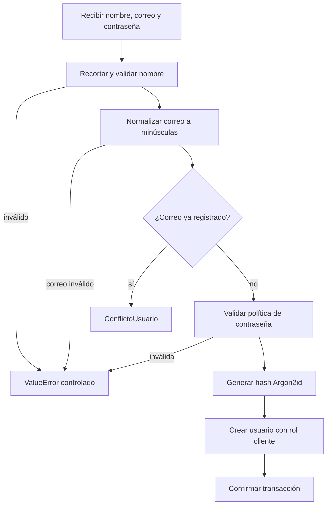
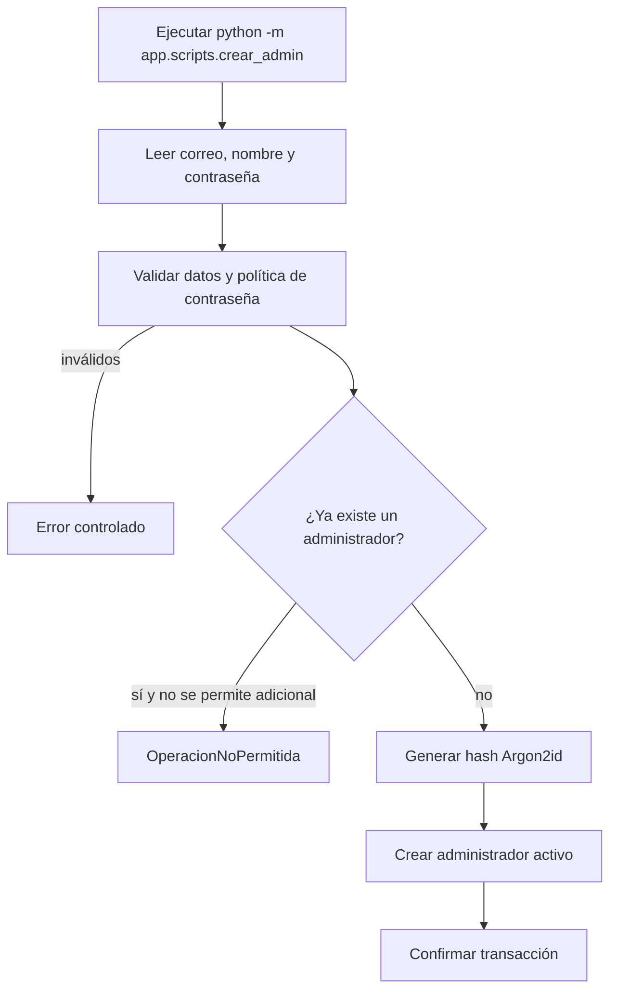
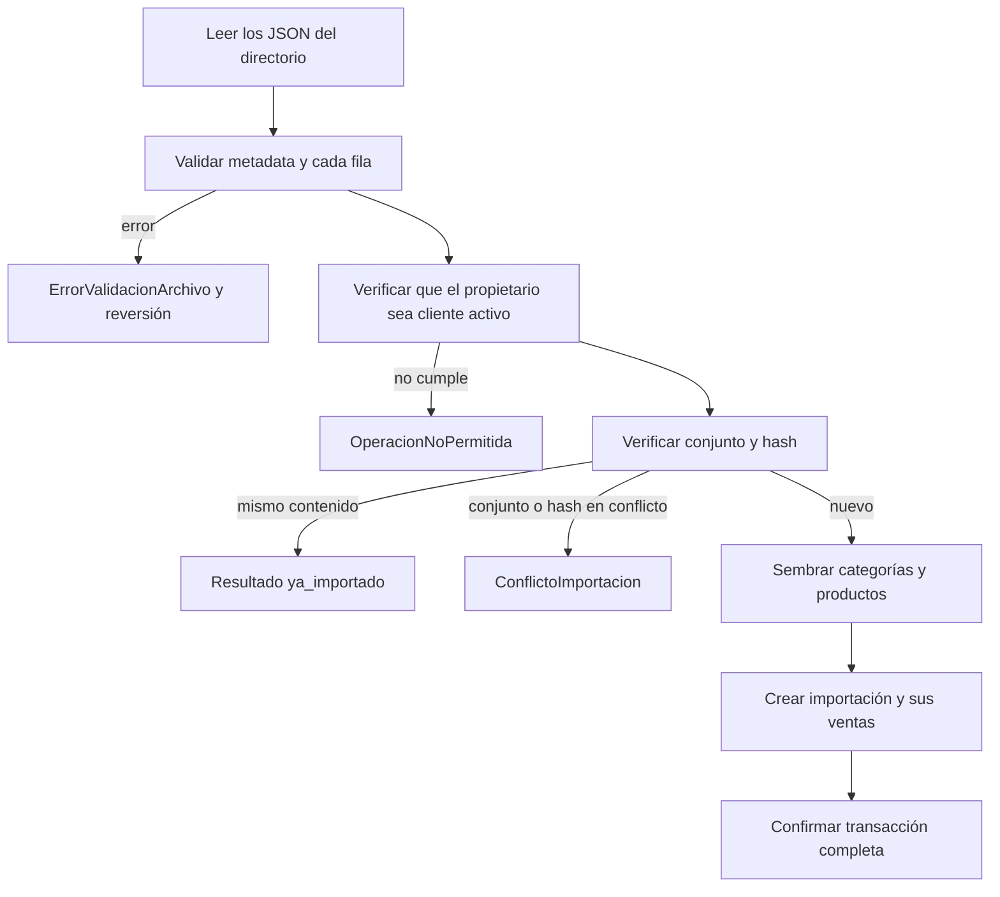
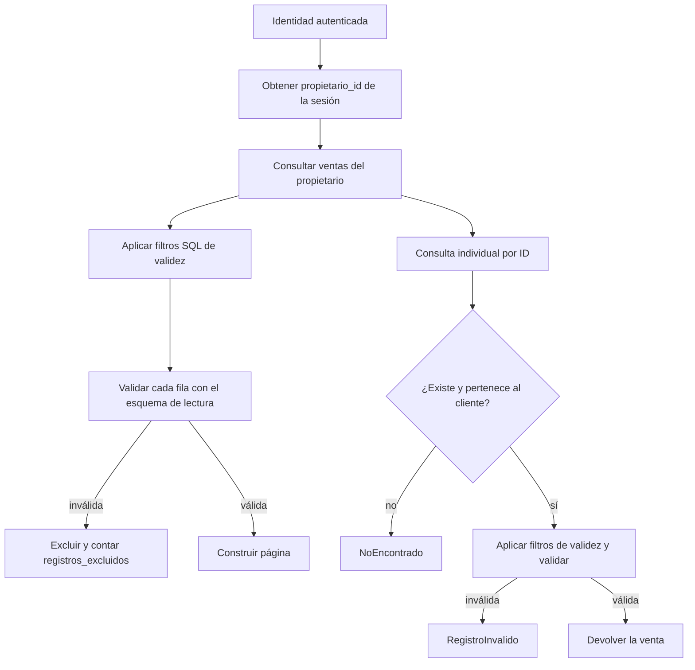
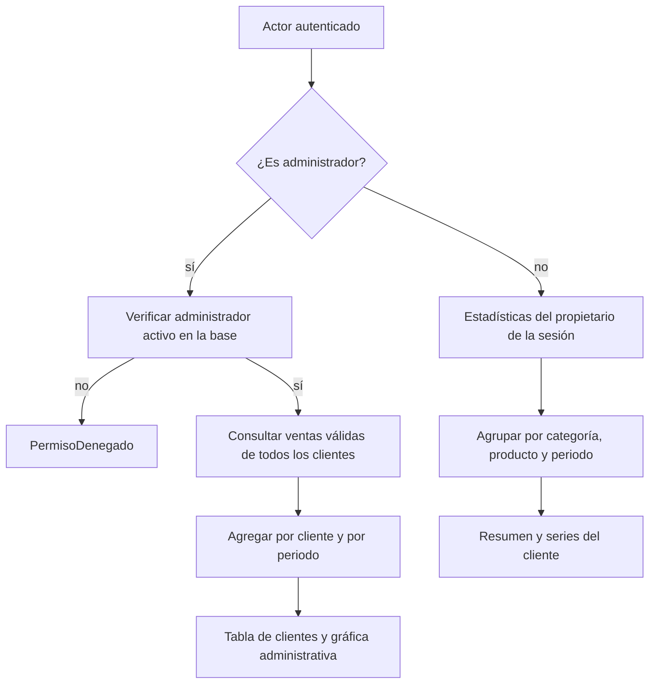
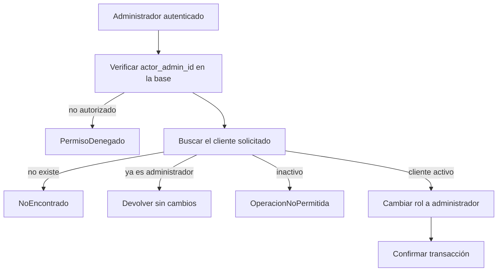
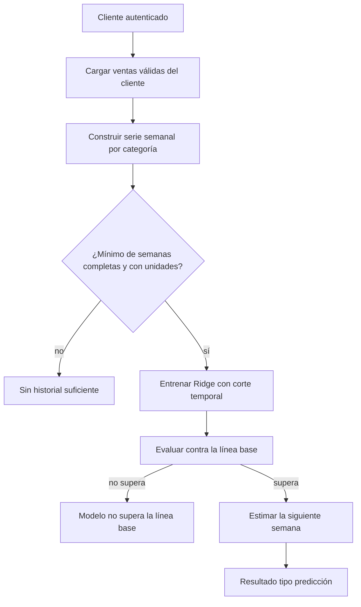

# Procesos, decisiones y manejo de errores

Este documento describe los procesos de datos implementados en la rama
`Ismael`. La capa HTTP y la aplicación móvil se integran en otras ramas; por eso
los procesos se describen desde los servicios y la base de datos, no desde
controladores inexistentes en este alcance.

## 1. Actores y responsabilidades

| Actor | Responsabilidad |
| --- | --- |
| Cliente | Consulta sus ventas, estadísticas y estimaciones. No puede elegir otro propietario. |
| Administrador | Consulta el resumen de clientes, promueve clientes activos y puede ejecutar la carga de demostración. |
| Proceso de inicialización | Crea la primera cuenta administradora mediante un comando controlado. |
| Proceso de carga | Valida y carga los cinco conjuntos simulados de demostración. |
| Motor de demanda | Calcula estimaciones semanales a partir de ventas válidas. |

## 2. Invariantes de seguridad

1. El servidor obtiene la identidad de la sesión autenticada. Ningún servicio
   acepta un rol, propietario o identificador de cliente desde el cuerpo, la URL
   o un cliente HTTP.
2. Las consultas de cliente exigen `propietario_id` y lo aplican como filtro
   obligatorio. Cambiar un identificador de venta no permite leer registros de
   otro cliente.
3. Las operaciones administrativas reciben `actor_admin_id` y verifican en la
   base de datos que la cuenta exista, esté activa y tenga rol
   `administrador`.
4. El registro público siempre crea `cliente`; la función no tiene parámetro de
   rol.
5. Las contraseñas se almacenan como hash Argon2id. Nunca se guardan en claro,
   ni en Git, ni en variables versionadas.
6. Las filas inválidas se excluyen de listados, estadísticas y predicciones. La
   consulta individual de una fila inválida devuelve un error controlado.
7. Una predicción siempre se presenta como estimación, con periodo, unidad,
   algoritmo y métricas. Si no hay base suficiente o el modelo no supera la
   línea base, no se publica una cifra inventada.

## 3. Catálogo de procesos

| Proceso | Entrada | Resultado | Errores controlados |
| --- | --- | --- | --- |
| Registro público de cliente | Nombre, correo y contraseña | Usuario con rol `cliente` | `ValueError`, `ConflictoUsuario` |
| Inicialización de administrador | Nombre, correo y contraseña por CLI | Primera cuenta `administrador` | `ValueError`, `ConflictoUsuario`, `OperacionNoPermitida` |
| Carga de demostración | Directorio con cinco JSON, cliente propietario | Importaciones y ventas persistidas | `ErrorValidacionArchivo`, `ConflictoImportacion`, `OperacionNoPermitida` |
| Listado de ventas del cliente | Identidad del cliente, filtros y paginación | Página de ventas válidas | `ValueError` |
| Consulta de una venta | Identidad del cliente e identificador | Venta propia | `NoEncontrado`, `RegistroInvalido` |
| Estadísticas del cliente | Identidad, periodo y agrupación | Resumen, categorías, productos y periodos | `ValueError` |
| Estadísticas administrativas | Identidad del administrador, periodo | Tabla de clientes y agregados | `PermisoDenegado`, `ValueError` |
| Listado administrativo de clientes | Identidad del administrador, paginación | Página de clientes | `PermisoDenegado`, `ValueError` |
| Promoción de cliente | Identidad del administrador e ID del cliente | Cliente con rol `administrador` | `PermisoDenegado`, `NoEncontrado`, `OperacionNoPermitida` |
| Predicción de demanda | Identidad del cliente, categoría y periodo | Estimación o limitación explicada | `ValueError` |

## 4. Registro público de cliente

Decisiones:

- `crear_cliente` no recibe `rol`; el valor `cliente` está fijado en el
  servicio.
- El correo se normaliza con `email_validator` sin consulta de entregabilidad y
  se almacena en minúsculas.
- La contraseña debe tener entre 12 y 128 caracteres, incluir al menos una letra
  y un dígito, no empezar ni terminar con espacios y no ser igual al correo.
- La restricción única de `usuarios.correo` es la última defensa contra
  duplicados concurrentes.

## 5. Inicialización de la primera cuenta administradora

Decisiones:

- Es un procedimiento documentado y fuera del registro público.
- La contraseña se solicita de forma interactiva o por una variable de entorno
  temporal; no se versiona.
- `--permitir-adicional` existe solo para una inicialización controlada. Sin esa
  opción, el servicio rechaza crear un segundo administrador.
- El hash se genera con Argon2id y la base exige el prefijo `$argon2id$`.

## 6. Carga de los datos de demostración

Decisiones:

- El directorio debe contener los cinco JSON; no se aceptan archivos
  sustitutos ni datos inventados.
- Todos los archivos se validan antes de escribir. La carga se ejecuta dentro de
  una transacción: un error en cualquier archivo revierte la operación completa.
- El propietario debe ser una cuenta `cliente` activa.
- El importador, si se indica, debe ser administrador. El comando de carga
  verifica ese rol antes de invocar el servicio.
- La idempotencia usa dos claves: `conjunto` y `hash_sha256`. Si el mismo
  contenido ya se importó, el resultado es `ya_importado`; si el conjunto o el
  hash cambian, se rechaza el conflicto.
- El catálogo se siembra desde los archivos y se verifica que un mismo
  `producto_id` conserve nombre y categoría en todos los conjuntos.
- Las ventas guardan `importacion_id` e `id_origen`; la FK compuesta impide
  cruzar propietarios.

## 7. Consulta de ventas del cliente

Decisiones:

- El listado aplica `propietario_id` en la consulta SQL; no filtra en memoria
  después de traer datos de todos.
- El límite de página debe estar entre 1 y 500; el desplazamiento no puede ser
  negativo.
- `cargar_ventas_validadas` aplica filtros de validez en SQL y después valida
  cada fila con Pydantic. Las filas que fallan se excluyen y se informa su
  cantidad en `registros_excluidos`.
- La consulta individual primero comprueba existencia y propiedad; si la venta
  es de otro cliente, devuelve `NoEncontrado` para no revelar que existe.
- Si la venta es propia pero no cumple las reglas, devuelve `RegistroInvalido`
  con los motivos.

## 8. Estadísticas del cliente y del administrador

Decisiones:

- Las estadísticas se calculan desde PostgreSQL, no desde los JSON.
- La agrupación acepta `semana` o `mes`; cualquier otro valor produce
  `ValueError`.
- Las semanas y meses parciales se marcan como incompletos para no compararlos
  con periodos completos.
- El administrador ve solo cuentas con rol `cliente` en la tabla; la promoción
  cambia el rol y deja de aparecer en ese listado.
- El resumen administrativo incluye clientes sin ventas y contabiliza los
  registros excluidos.

## 9. Promoción de cliente a administrador

Decisiones:

- La promoción es idempotente si el usuario ya es administrador.
- No se promueve una cuenta inactiva.
- El rol no se recibe desde la petición; se asigna en el servicio después de
  verificar al actor.
- La operación requiere una cuenta administradora activa, aunque se invoque
  directamente con otra herramienta.

## 10. Predicción de demanda

Decisiones:

- Solo se usan semanas completas. La semana objetivo es la siguiente a la última
  semana completa.
- La evaluación es cronológica: las últimas cinco semanas se reservan para
  comparar el modelo contra la línea base de la última semana observada.
- El modelo no publica una estimación si el MAE no es menor que el MAE de la
  línea base.
- La salida distingue tres resultados: `prediccion`, `sin_historial_suficiente`
  y `modelo_no_supera_linea_base`.
- La unidad es unidades vendidas por categoría por semana. La predicción es una
  estimación y no se persiste.

## 11. Transacciones

- Los servicios usan `flush()` para obtener identificadores y dejar los cambios
  en la sesión; no confirman por sí mismos.
- Los comandos de inicialización y carga abren una transacción con
  `session.begin()`: confirman al terminar o revierten ante cualquier excepción.
- La carga completa de los cinco archivos es una sola operación lógica. No se
  aceptan cargas parciales.
- La restauración de una base de pruebas se hace recreando el esquema y
  aplicando las migraciones; nunca se apunta a datos reales.

## 12. Errores de dominio

| Error | Se produce cuando | Efecto |
| --- | --- | --- |
| `ErrorValidacionArchivo` | El JSON no se puede leer, no es UTF-8, es inválido, falta metadata o una fila incumple reglas. | Se rechaza el archivo con archivo, fila, campo y motivo; no se escribe. |
| `ConflictoImportacion` | El conjunto ya existe con otro contenido o el hash ya se importó con otro conjunto. | Se rechaza la carga y se revierte la transacción. |
| `ConflictoUsuario` | El correo ya está registrado. | No se crea la cuenta. |
| `NoEncontrado` | La venta no existe o pertenece a otro cliente. | Error controlado sin revelar datos ajenos. |
| `RegistroInvalido` | La venta es propia pero no cumple las reglas de validez. | Error controlado con la lista de motivos. |
| `PermisoDenegado` | El actor no existe, está inactivo o no es administrador. | Se rechaza la operación administrativa. |
| `OperacionNoPermitida` | Ya existe un administrador, el propietario no es cliente activo o se intenta promover una cuenta inactiva. | Se rechaza la operación. |
| `ValueError` | Un parámetro de entrada no cumple el rango o el formato. | Se informa el motivo sin escribir datos. |

La equivalencia con códigos HTTP corresponde a la capa de rutas, que no forma
parte de esta rama: validación `400`/`422`, conflicto `409`, no encontrado
`404` y permiso `403`. La lógica de datos no depende de esa traducción.

## 13. Límites de esta rama

- No se implementan rutas HTTP, inicio de sesión ni emisión de tokens.
- No se modifica la aplicación móvil.
- No se persisten predicciones ni se generan tableros visuales.
- Los JSON solo se usan para la carga inicial; las consultas siempre leen la
  base de datos.
